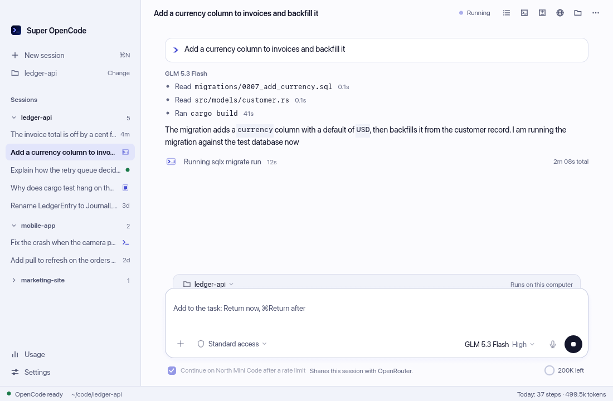
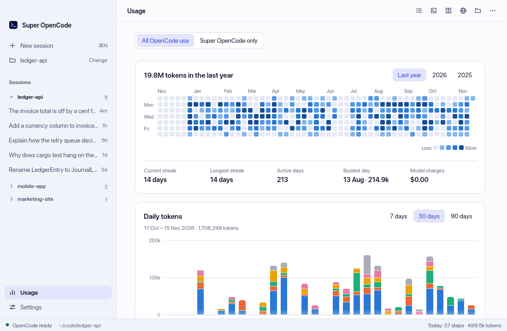
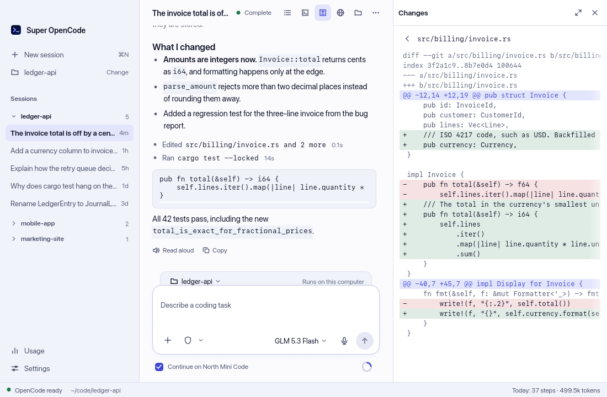
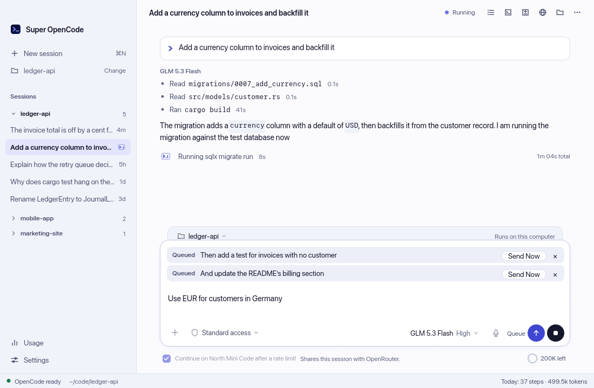
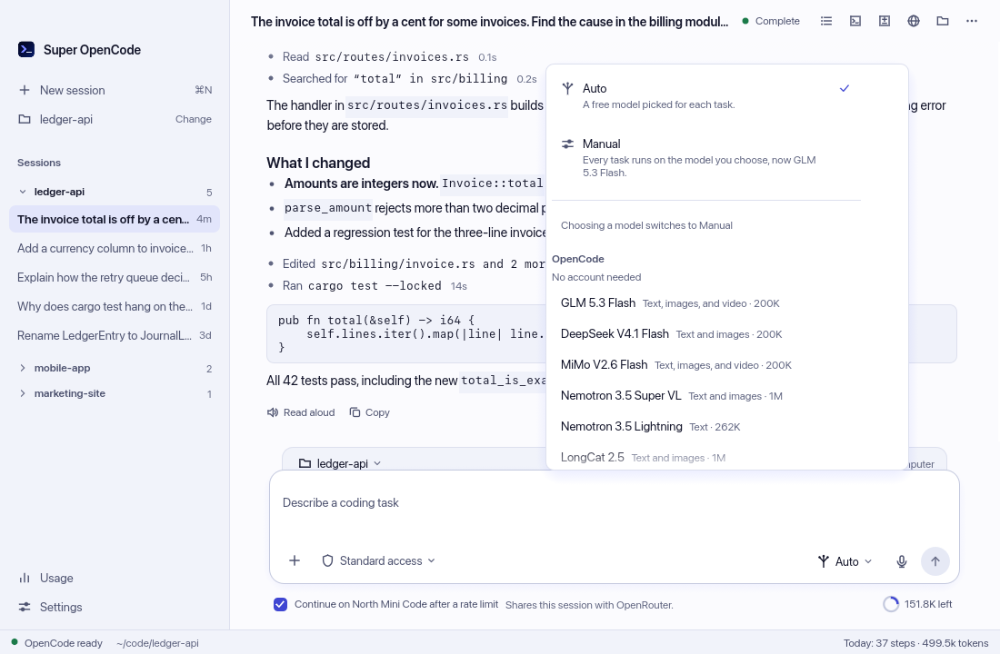
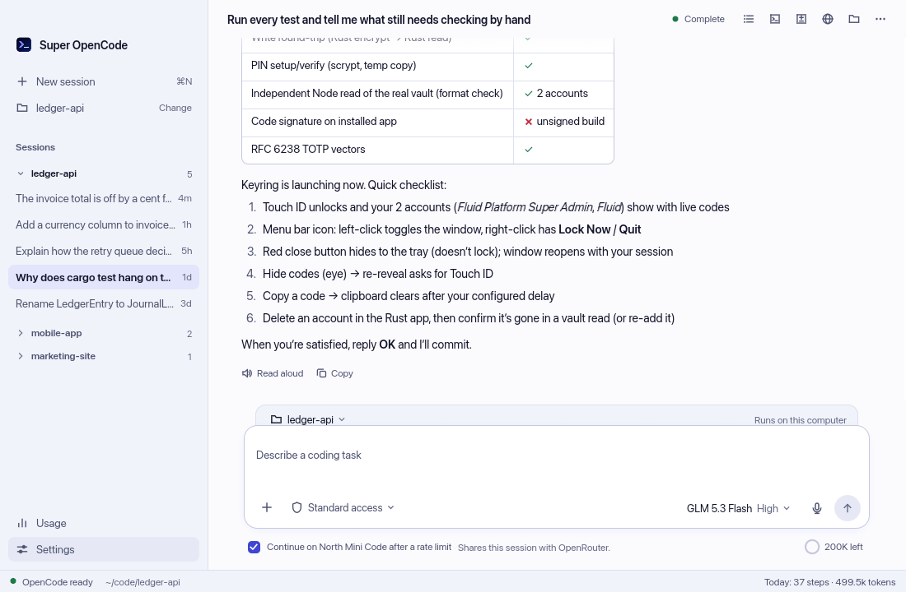
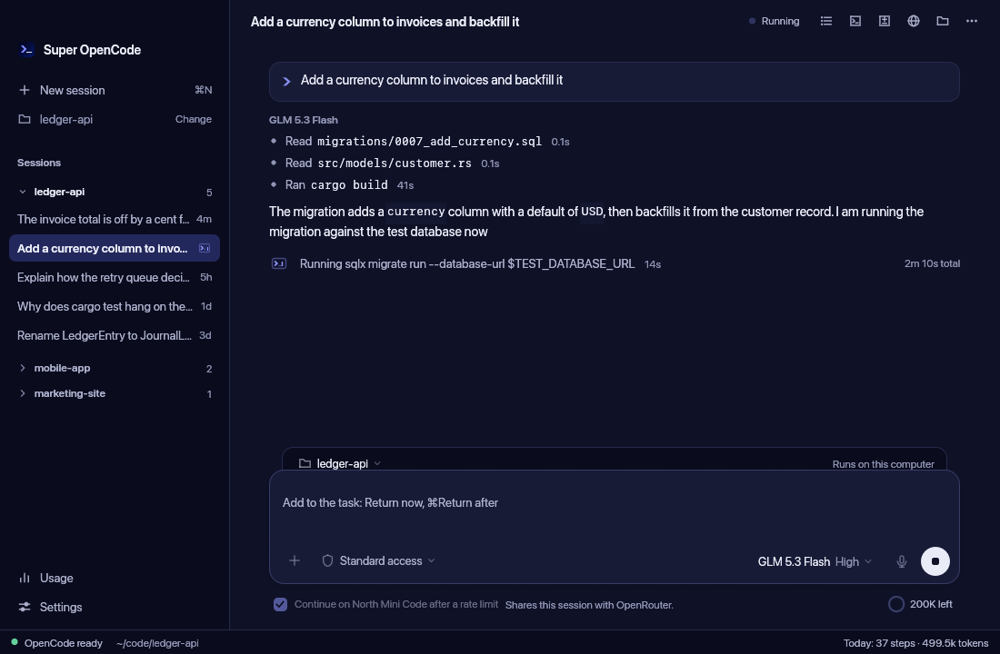

# Super OpenCode

A desktop app for [OpenCode](https://opencode.ai), the open-source coding agent, that runs only free models. It is written in Rust and runs on macOS, Windows, and Linux.



## What it does

- Runs OpenCode in your project folder and shows each step as it happens: what it is reading, running, or editing, and how long each step took.
- Offers only models priced at $0: OpenCode's own free models, OpenRouter's `:free` models, the free models of NVIDIA NIM, ModelScope, Z.ai, Google AI Studio, and Hugging Face once you add a free key, and models running on your computer in Ollama, LM Studio, or vLLM. Any other model is refused before it runs.
- Lets you choose the model yourself, or turn on Auto to have a quick, everyday, or hard model picked for each task. Each reply says which model ran and why.
- Runs several sessions at once, in any projects. While a task runs, you can send it another message or queue the next task.
- Opens a pane beside the conversation with OpenCode's to-do list, a terminal, the project's Git changes, a browser with tabs, and the project's files.
- Takes files, pictures, audio, documents, and folders as attachments. Dictation and audio are transcribed on your computer, and replies can be read aloud.
- Shows your usage over time: a year of activity drawn like GitHub's contribution graph, your streaks, and daily tokens by model.

## Screenshots

| | |
|---|---|
|  |  |
| Usage: a year of activity, streaks, and daily tokens by model | Changes: the project's Git diff beside the conversation |
|  |  |
| Adding to a running task, with two messages queued | Auto or Manual model choice |
|  |  |
| Replies with tables, lists, and each step's time | The dark theme |

## Get started

1. Download the installer for your platform from the [latest release](https://github.com/desmondknunoo/super-opencode/releases/latest): `Super-OpenCode-macos-arm64.dmg`, `Super-OpenCode-macos-x64.dmg`, `Super-OpenCode-windows-x64.exe`, or `Super-OpenCode-linux-x64.deb`.
2. Install it: drag the app from the DMG to Applications on macOS, run the `.exe` on Windows, or run `sudo apt install ./Super-OpenCode-linux-x64.deb` on Debian/Ubuntu.
3. Open it. If OpenCode isn't installed, the app installs it with OpenCode's own installer, and a short tutorial covers the rest.
4. Choose a project folder, describe a task, and press Return.

## Build

You need Rust 1.99.1 and CMake. The speech engine, whisper.cpp, is compiled from source and also needs Clang. On Linux, install pkg-config, libclang, and the OpenGL, xkbcommon, and ALSA development libraries.

```sh
cargo test --locked
cargo build --release --locked
```

To make the macOS app bundle:

```sh
MACOSX_DEPLOYMENT_TARGET=12.0 cargo build --release --locked
scripts/package-macos.sh target/release/super-opencode
```

## Guide

Models, attachments, voice, the side pane, usage, settings, and the command line are covered in [the guide](docs/guide.md).

## Credits

Made by [desmondknunoo](https://github.com/desmondknunoo). Built on [OpenCode](https://opencode.ai).

## License

MIT, the same license as OpenCode. See [LICENSE](LICENSE).
